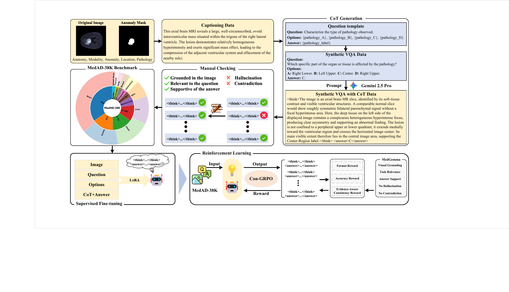
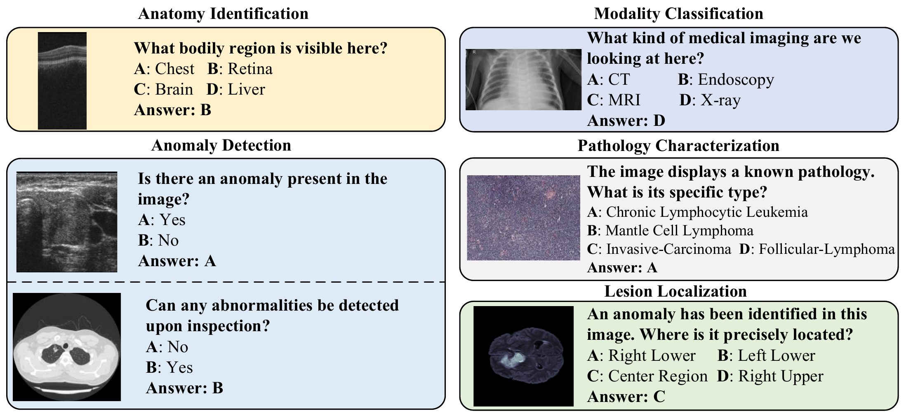

# MedAD-R1

### Consistency-Reinforced Policy Optimization for Interpretable Medical Anomaly Detection

[**Paper**](https://arxiv.org/abs/2602.01081) · [**Code**](https://github.com/zhtstar/MedAD-R1) · [**Dataset**](https://huggingface.co/datasets/zhtstar/MedAD-38K) · [**Model**](https://huggingface.co/zhtstar/MedAD-R1)

> **Release status.** This repository is the project landing page. The implementation is being prepared. Model access requires a manually reviewed request. The dataset page is live, but its files are still being validated and have not been uploaded. We plan to make the project resources openly available after the paper is accepted, subject to the permissions of the underlying data sources. The linked arXiv record may currently show an earlier manuscript version.

## Overview

Medical anomaly detection needs more than a correct answer: a useful explanation should point to image evidence and support the final decision. **MedAD-R1** addresses this with a two-stage training framework built on **MedAD-38K**, a benchmark of medical-image visual question answering (VQA) with quality-controlled diagnostic reasoning annotations.

- **MedAD-38K:** The revised manuscript reports **38,422 images** and **130,146 VQA instances** from **16 public datasets**, covering **10 imaging modalities**, **10 anatomical regions**, and five tasks: anatomy identification, modality classification, anomaly detection, pathology characterization, and lesion localization. These are manuscript statistics; the dataset release is still being validated.
- **Cognitive Injection:** Supervised fine-tuning (SFT) teaches the model domain knowledge and the structured `<think>...</think><answer>...</answer>` response format.
- **Con-GRPO:** Consistency Group Relative Policy Optimization rewards correct answers together with reasoning that is visually grounded, relevant to the question, supportive of the answer, free of hallucinations, and non-contradictory.

  
   
  <em>Dataset construction and training framework from the revised manuscript.</em>

## Benchmark and results

The benchmark evaluates five complementary medical-image questions. The examples below are taken from the paper.

  

The following numbers are **reported in the revised manuscript** (percent, higher is better):

| Model / training | Parameters | MedAD-38K accuracy | Reasoning–answer consistency | External accuracy |
| :-- | --: | --: | --: | --: |
| Qwen3.5, zero-shot | 0.8B | 76.43 | 92.12 | 68.12 |
| Qwen3.5, SFT only | 0.8B | 90.89 | 94.35 | 88.36 |
| Qwen3.6, fine-tuned on our training split | 27B | 92.75 | 92.10 | 84.27 |
| **MedAD-R1 (SFT + Con-GRPO)** | **0.8B** | **95.12** | **97.26** | **90.09** |

Accuracy is micro-averaged over applicable VQA instances. External accuracy is evaluated on five source-disjoint datasets. See the paper and supplement for the full baseline set, uncertainty estimates, and evaluation protocol.

## Resources

| Resource | Link | Current status |
| :-- | :-- | :-- |
| Paper | [arXiv:2602.01081](https://arxiv.org/abs/2602.01081) | The public arXiv version may lag the revised manuscript summarized here. |
| Code | [GitHub: zhtstar/MedAD-R1](https://github.com/zhtstar/MedAD-R1) | Implementation in preparation. |
| Dataset | [Hugging Face: zhtstar/MedAD-38K](https://huggingface.co/datasets/zhtstar/MedAD-38K) | Information page is live; validated files forthcoming, with manual access review. |
| Model | [Hugging Face: zhtstar/MedAD-R1](https://huggingface.co/zhtstar/MedAD-R1) | Access by request while the paper is under review. |

## Citation

If this work is useful, please cite the [arXiv paper](https://arxiv.org/abs/2602.01081). We will update the citation details when the revised version is public.

## Release plan

While the paper is under review, model and dataset access will be managed through requests. We plan to release the code, model, and validated dataset openly after acceptance, subject to the original datasets' licenses and redistribution terms.
